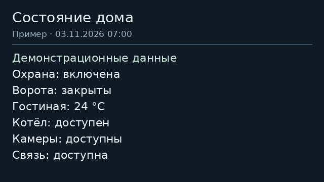

# Уведомления на внутренний монитор Hikvision

Переносимый Python-модуль для локальной отправки русского текста и одной JPEG
на внутренний монитор через HCNetSDK, командой `16008`. Есть обычный тип notice
и тревожный alarm. Изображение — снимок камеры или создаваемая карточка состояния.
Логин, SDK и существующие вызовы/реле не переопределяются.

## Статус

Публичная адаптация подготовлена 03.11.2026. Самостоятельный модуль и MQTT-адаптер
проверены автономно с синтетическими данными. Адаптер предложен в
[draft PR #393](https://github.com/pergolafabio/Hikvision-Addons/pull/393);
наличие файлов здесь не означает его включение в стабильный add-on.
`upstream.patch` применяется к upstream commit
`eb5be4f95e66d2abdc575bb637a25b8511f7d05d`.

На нашей исходной установке VDP-H3212W, V2.2.22 build 230720 пользователь ранее
подтвердил русский текст, JPEG и короткую штатную сирену alarm. Переносимый
MQTT-адаптер на приборе отдельно не испытывался. Принятие SDK не доказывает
показ на экране, звук или прочтение. Подтверждения прочтения пока не реализованы.
Другие модели/прошивки требуют отдельной проверки. ABI ограничен 64-битным Linux;
проверенные размеры структуры: NOTICE1552/PIC48/TIME8, смещение pictures1136.

## Что внутри

| Файл | Назначение |
|---|---|
| `indoor_notice.py` | ABI, UTF-8, JPEG, ограниченный отправитель, постоянный SQLite-журнал |
| `pictures.py` | Локальная нормализация снимков и карточки состояния, optional Pillow |
| `examples/ha-notice-script.yaml` | Скрипт HA для явной MQTT-отправки |
| `examples/binary-alert-blueprint.yaml` | Пример тревоги бинарного датчика и восстановления |
| `examples/card.json` | Только демонстрационные данные для изображения |
| `examples/card-preview.jpg` | Проверенный статический пример карточки |
| `upstream.patch` | Изолированные изменения SDK/MQTT-адаптера и его тестов |
| `tests/` | Границы, перезапуск, дубли, unknown, приватность, JPEG и C ABI |

## Подключение

Сначала нужен add-on с рассматриваемым изменением. Для проверки патча в отдельном
checkout Hikvision-Addons, без установки на рабочий домофон:

```sh
git checkout eb5be4f95e66d2abdc575bb637a25b8511f7d05d
git apply --check /path/to/indoor-notifications/upstream.patch
git apply /path/to/indoor-notifications/upstream.patch
```

Не запускай второй отправитель на тот же монитор параллельно с существующей
домашней интеграцией. Этот пакет сам ничего не устанавливает и не отправляет.
Собственных сервисов, Proxmox/QGA, облака и нового брокера ему не требуется.
SDK поставляется существующим add-on; его бинарные библиотеки сюда не включены.

Для каждого настроенного indoor публикуется точная команда
`hikvision/<name>/notice/set`, результат — `hikvision/<name>/notice/result`.
`<name>` совпадает с нормализацией add-on: нижний регистр, только буквы/цифры,
без пробелов и дефисов. Пустые/неоднозначные имена отключают новый command topic.
Права брокера должны разрешать отправку только доверенным клиентам.

```json
{
  "id": "ha-example-001",
  "title": "Проверка дома",
  "text": "Ворота закрыты. Все системы доступны.",
  "level": "alarm",
  "expires_at": 1793674860,
  "picture": "home-status.jpg"
}
```

Пример времени статический: перед реальной отправкой `expires_at` задаётся как
текущий Unix timestamp +60 секунд. Допустимое окно — максимум 300 секунд.
`picture` необязателен, `level` по умолчанию `notice`. `id` обязателен и должен
быть устойчивым для одного события. HA-пример вычисляет время автоматически.
Команды публикуются с `retain: false`. Сообщения с broker retain flag
отклоняются: так брокер помечает доставку сохранённой команды новой подписке.

Заголовок до63, текст до1023 **байт UTF-8**, ID до31 ASCII символа. Русская буква
обычно занимает два байта. Лишние/повторяющиеся поля JSON и NUL запрещены.
Один JPEG до24KiB и640×360, baseline RGB, без EXIF/произвольных метаданных.
Допускается только имя `*.jpg` из фиксированной `/media/hikvision-notices`:
URL, абсолютные пути, переходы каталогов, symlink и FIFO не принимаются.
Структурная проверка в отправителе не заменяет декодер: используй доверенные
снимки после нормализации `pictures.py`. При ошибке картинки команда целиком
отклоняется; отправить один текст можно отдельным осознанным событием.

`alarm` запрашивает штатный тип3 со звуком. Громкость, talkVolume, сцены охраны,
тихие часы и настройки звонков этот адаптер не меняет. Нулевая громкость может
подавить звук. Наше восстановление громкости с durable lease относится к
действующей домашней интеграции; перенос этого механизма — отдельное изменение.
Длительность сирены определяет прошивка. TTS и управление длительностью здесь нет.

## Результат, перезапуск и ограничения

| status | Значение |
|---|---|
| `accepted` | SDK подтвердил принятие команды прибором |
| `rejected` | SDK вернул определённый отказ |
| `unknown` | Таймаут, сбой транспорта или незавершённая отправка; результат неизвестен |
| `not_sent` | Проверка входа, idle, лимита или доступности отклонила команду до отправки |

Перед SDK write выполняется FULL synchronous commit в приватный SQLite-журнал.
Повтор того же ID не вызывает вторую отправку; изменение текста, картинки или
level с тем же ID даёт conflict. После аварии sending считается unknown.
Новый ID после unknown также блокируется до административного разбора.
В MQTT-результате `duplicate=true` и `send_attempted=false` описывают повторный
запрос. Сообщения результатов не retained и не гарантируют отдельный ACK клиенту.

SQLite находится в `/data/notice-journal/notices.sqlite3` (в Docker development
— `./data/notice-journal`). Каталог0700, БД0600. В ней только хэши, ID, время,
статус и код SDK. Тексты, снимки, пароли и serial туда не записываются.
Одна попытка на прибор в60 секунд, максимум4096 записей суммарно; пределы
постоянные, переполнение останавливает новые команды. Старые записи автоматически
не удаляются. Сохраняй `/data` при обновлении и откате: удаление журнала уничтожает
защиту от повторов. Нужен локальный файловый раздел с нормальными SQLite/fsync.

После исследования unknown администратор может разрешить **новые** события:

```python
from pathlib import Path
from indoor_notice import NoticeService
service = NoticeService(Path('/data/notice-journal'), Path('/media/hikvision-notices'))
service.review(target_sha256_from_journal, notice_id)
```

Это сохраняет исходный статус/ID и ставит reviewed_at; старый ID не повторяется.
Не заменяй unknown на accepted без доказательств и не удаляй БД ради retry.

Свежий callStatus должен быть ровно idle. Чтение и отправка не являются атомарной
операцией прибора: новый звонок между ними остаётся возможной гонкой. Очереди,
повтора при busy и воспроизведения старых тревог после перезапуска нет.

## Картинки

Для локального инструмента нужен Pillow; add-on новых Python-зависимостей не получает.
Шрифт должен поддерживать кириллицу, например установленный DejaVuSans.

```sh
python3 -m pip install -r requirements-pictures.txt
python3 pictures.py card examples/card.json home-status.jpg \
  --font /usr/share/fonts/truetype/dejavu/DejaVuSans.ttf
python3 pictures.py normalise camera-original.jpg camera-normalised.jpg
```

Команды создают новый файл и отказываются перезаписывать существующий. Затем
владелец помещает нормализованный файл в `/media/hikvision-notices`. Не размещай
частные снимки в публичном `www` и в Git. Снимок камеры по текущему запросу не
доказывает время события; карточка — статическое изображение, не интерактивный HA.



Пример HA-blueprint требует реально настроенного бинарного датчика. Восстановление
ждёт65 секунд, чтобы одиночная пара problem/recovery укладывалась в лимит60 секунд.
Несколько одновременных событий разных правил могут получить `rate_limited`:
для них прикладному слою нужна своя группировка/свежая очередь и контроль результатов.
Дым/газ/вода
не считаются защищёнными без настоящих датчиков. Выдержка `for` в таком примере
начинается заново после перезапуска HA; это не полный движок домашних эпизодов.
Наша группировка29 правил, MAX, независимый watchdog и управление quiet lease
остаются отдельным прикладным слоем. Полезный следующий вклад — адаптируемые
health/recovery правила и независимый контроль heartbeat отправителя.

## Проверка и откат

```sh
python3 -B -W error::ResourceWarning -m unittest discover -s tests -v
```

Core-тесты работают без SDK/сети. Для `test_pictures.py` нужен Pillow, для
нативного теста ABI — C-компилятор. Тесты не включают сирену и не управляют реле.
Подробные границы — [VALIDATION.md](VALIDATION.md).

Откат — revert только файлов нового модуля/MQTT-хуков, сохранив `/data` и картинки.
Не откатывай одновременно рабочие SIP/DECT или домашнюю систему уведомлений.
Установка форка и перезапуск production в эту публикацию не входят.

## Происхождение

Объявления поддерживаются производителем давно: [инструкция Hikvision](https://www.hikvisioneurope.com/eu/portal/portal/Technical%20Materials/07%20%20Video%20Intercom/03%20%20How%20to%20Guidance/1st%20Gen/How%20to%20Send%20Notices%20to%20Indoor%20Station%20from%20iVMS-4200.pdf).
На GitHub есть [C++ пример HCNetSDK](https://github.com/yyj8209/HikSyn/blob/master/DlgVideoIntercomNoticeDataCfg.cpp).
Новая работа здесь — переносимый отправитель и интеграция с ограничениями,
журналом и проверками. Мы не заявляем изобретение SDK-функции.

Новые исходники в этом каталоге — MIT, см. [LICENSE](LICENSE).
`upstream.patch` содержит контекст чужого проекта; лицензия нашего нового модуля
не изменяет права на upstream или проприетарный SDK.
