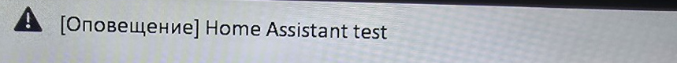
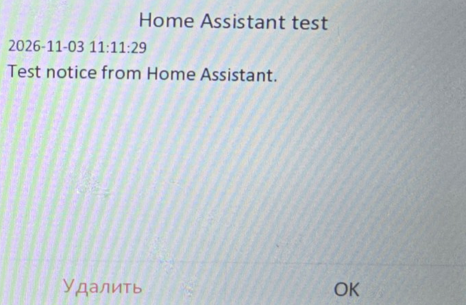

# PR #394: native text notice displayed on VDP-H3212W

Evidence for [the minimal fixed-notice PR](https://github.com/pergolafabio/Hikvision-Addons/pull/394), source [`d17398ec6216`](https://github.com/giflydimarik-gif/Hikvision-Addons/commit/d17398ec6216c144dc1b49a22aad712d45a1c640), collected on 2026-11-03.

| Item | Observation |
| --- | --- |
| Station | VDP-H3212W |
| Firmware | V2.2.22 build 230720 |
| Command | NET_DVR_RemoteControl 16008 |
| Buffer | 1552 bytes; normal notice level 4; zero pictures |
| Native writes | Exactly one real call |
| SDK result | accepted; error null |
| Visible title | Home Assistant test |
| Visible body | Test notice from Home Assistant. |

The unchanged PR notice structs, `send_test_notice()` and `_test_notice_callback()` were extracted from the pinned source and executed against the real station using its existing SDK. A QA wrapper supplied bound-target/capability checks, the existing send lock and a durable no-retry claim. The source blobs were verified before execution. Existing settings and journals were preserved.

The owner then supplied these two photographs. The first shows the title on the main screen; the second shows the opened message and the exact body. The image files contain only crops of those photos, with unrelated notification history and metadata removed. Message content was not redrawn or retouched.





The station displays record time `2026-11-03 11:11:29`. The SDK test was logged at 11:09:56–58 Moscow time. The clocks were not compared, so these timestamps are not a delivery-latency measurement.

## Log and limits

```text
Received test notice command for IndoorNoticeBounded (retain=False, dup=False, press=True)
NET_DVR_RemoteControl: command=16008, size=1552, level=4, pictures=0, native_calls=1
Test notice accepted by SDK for IndoorNoticeBounded; display is not confirmed
```

That last line is the sender's real log at send time. The later owner photos provide the separate visual confirmation. [Machine-readable result and image hashes](sdk-result.json).

This establishes native text rendering on this station/firmware. The HA entity's live click path remains to be verified; the full fork was not installed in the working home system. Sound, automatic screen wake and an SDK reading-receipt callback were not tested by these photos. The unchanged PR revision passed all five GitHub CI jobs; its local suite passed 72 tests with 8 hardware-only tests skipped.
